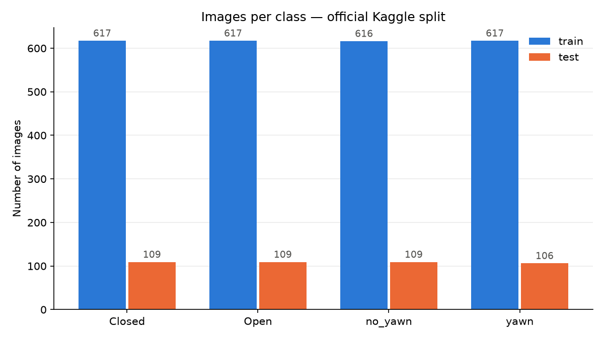
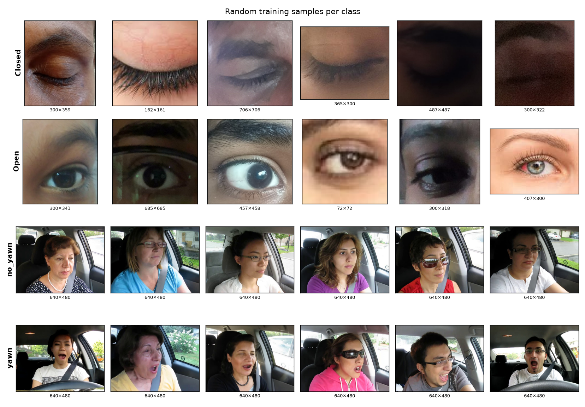
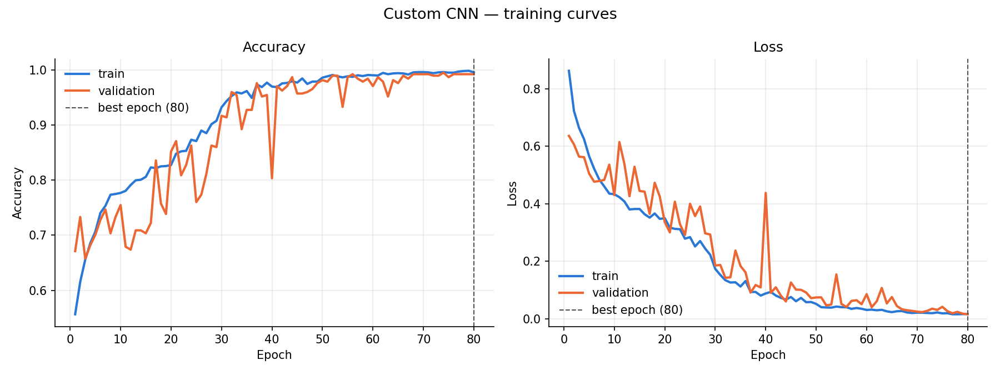
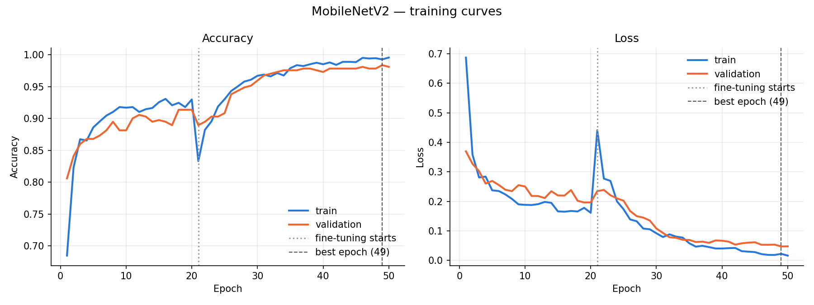
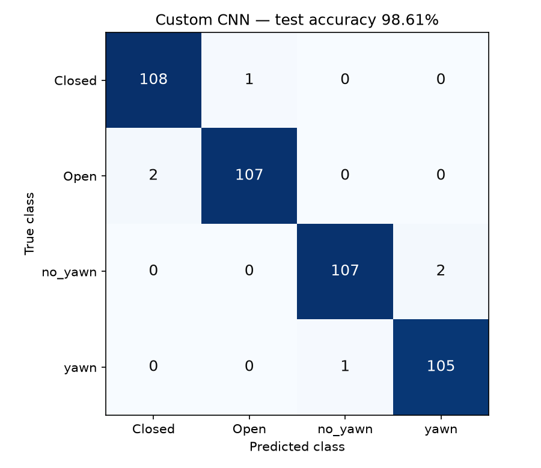

# Driver Drowsiness Detection System

A real-time system that watches a driver through a webcam and raises an **audible alarm** when the driver's eyes stay closed too long, and detects **yawning**, using a custom-trained deep-learning CNN combined with Google's MediaPipe face landmarks.

> **In one paragraph:** every second a webcam frame is sent from the browser to a Python (FastAPI) server. There, a pre-trained **MediaPipe** model finds the face and 478 landmark points. Both eyes are cropped and classified as **Open / Closed** by **our own CNN**, trained on the Kaggle *Yawn-Eye* dataset. The lip landmarks give the **mouth aspect ratio**, which detects **yawning**. A tracker measures how long the eyes stay closed; at **≥ 2 seconds** the browser sounds a siren.

---

## 1. Problem statement

Drowsy driving causes a large share of road accidents: a tired driver's eyes close for longer than a normal blink (micro-sleep), and yawning becomes frequent. The goal is a lightweight system that:

- detects **eye state** (open / closed) and **yawning** from a normal webcam,
- tracks them **over time** (a blink is ~0.3 s; a micro-sleep lasts seconds),
- raises an **alarm** in real time on an ordinary laptop **CPU** (target < 50 ms per frame).

## 2. How it works

```
OFFLINE — training (Jupyter notebooks, done once)
  Kaggle dataset → 01 prepare → 02 train custom CNN → 02b train MobileNetV2 → 03 compare on test set → 04 export best model
                                                                                                        │
ONLINE — live system (every second)                                                                     ▼
  Webcam ─► Browser (test_frontend) ─► FastAPI backend ─► MediaPipe face landmarks (478 points)
              ▲  status + siren           │                   ├─► 2 eye crops ─► OUR CNN ─► Open / Closed
              └────── JSON result ◄───────┘                   └─► lip points  ─► mouth aspect ratio ─► yawn
                                     tracker: eyes closed ≥ 2 s → drowsy_alert  |  mouth wide open ≥ 3 s → yawn
```

**Hybrid design — why two methods?**

| Signal | Method | Reason |
|---|---|---|
| Eyes open / closed | **Our CNN** on landmark-based eye crops | The eye images come from many different people, so the CNN generalises to new faces (verified on a new user's webcam photos: 98.5–98.9 % "Closed" for shut eyes). |
| Yawning | **Mouth Aspect Ratio (MAR)** = inner-lip gap ÷ mouth width, from MediaPipe landmarks | The CNN scored 98.6 % on yawns in the test set but **failed on a new person's face**: the dataset's yawn frames come from a few dashcam drivers, and the test set has the same people. Geometry does not depend on who the driver is. |

## 3. Dataset

- **Source:** *Yawn Eye Dataset (new)* by serenaraju, Kaggle — <https://www.kaggle.com/datasets/serenaraju/yawn-eye-dataset-new>
- **Classes:** `Closed`, `Open` (close-up **eye crops**, ~300 px) and `no_yawn`, `yawn` (full **640×480 in-car frames**)
- **2,900 images**, balanced (imbalance ratio 1.002), 0 corrupt files (2 RGBA images converted to RGB)

| Split | Closed | Open | no_yawn | yawn | Total |
|---|---|---|---|---|---|
| Train | 524 | 524 | 524 | 524 | **2,096** |
| Validation (15 % of official train, stratified) | 93 | 93 | 92 | 93 | **371** |
| Test (official Kaggle test split, untouched) | 109 | 109 | 109 | 106 | **433** |

**Data-leakage check:** a perceptual hash (dHash, ≤ 10 of 256 bits) showed that **102 of the 433 test images** (all in the yawn classes: 50 `no_yawn`, 52 `yawn`) are near-identical video frames of training images. The eye classes have **no leakage**. We therefore also report **leak-free accuracy** (331 test images).




## 4. Models

### 4.1 Custom CNN (deployed)

```
Input 128×128×3 (raw 0–255 RGB)
 → Augmentation (training only): horizontal flip, rotation ±18°, zoom ±10 %, brightness ±20 %
 → Rescaling 1/255
 → [Conv 3×3 → BatchNorm(momentum 0.9) → ReLU → MaxPool 2×2] × 4     (32 → 64 → 128 → 256 filters)
 → GlobalAveragePooling → Dropout 0.4 → Dense(4) + Softmax
```

- **390,884 parameters** — Global Average Pooling instead of Flatten keeps it small and fast.
- Adam (lr 1e-3), sparse categorical cross-entropy, batch 32, ≤ 80 epochs, with checkpoint (best `val_loss`), early stopping (patience 15) and learning-rate halving (patience 5).
- Normalization is **inside the model**, so the server cannot preprocess differently from training.

**Training history (Colab T4 GPU):**

| Run | Change | Best epoch | Val accuracy |
|---|---|---|---|
| 1 | baseline (40 epochs) | 36 | 87.6 % (still improving: underfitting) |
| 2 | 80 epochs, more patience | 9 | 71.7 % (stopped too early) |
| **3** | **BatchNorm momentum 0.99 → 0.9**, patience 15 | **80** | **99.19 %** (val loss 0.016, train acc 99.52 %) |

The fix in run 3 came from diagnosing that BatchNorm's running averages lagged behind the fast-changing weights, so validation was scored with out-of-date statistics.



### 4.2 MobileNetV2 (transfer learning, for comparison)

Google's MobileNetV2 (pre-trained on ImageNet; depthwise-separable convolutions + inverted residual blocks), 128×128 input with `[-1, 1]` rescaling inside the model, new head (GAP → Dropout 0.3 → Dense 4).
- **Phase 1:** base frozen, train only the head (5,124 weights), lr 1e-3, 20 epochs → val acc 91.4 %
- **Phase 2:** fine-tune layers 100–153 (1.87 M weights), lr 1e-5, 30 epochs → **val acc 98.38 %** (best epoch 49)



## 5. Results (held-out test set, 433 images)

All numbers come from [`model/results/metrics.json`](../model/results/metrics.json) (notebook 03). Latency is measured on a laptop CPU (Intel Core i5-1135G7), one image, compiled `predict_on_batch`, median of 100 runs.

### 5.1 Overall results — Custom CNN (deployed model)

| Metric | Custom CNN |
|---|---|
| **Accuracy** | **98.61 %** |
| **Precision (macro)** | **98.62 %** |
| **Recall (macro)** | **98.62 %** |
| **F1-score (macro)** | **98.61 %** |
| Accuracy — eye classes (218 imgs) | 98.62 % |
| Accuracy — yawn classes (215 imgs) | 98.60 % |
| Accuracy — leak-free images (331) | 98.49 % |
| Best validation accuracy | 99.19 % |
| CPU latency per image | 3.2 ms |
| Parameters | 390,884 |
| File size | 4.78 MB (1.65 MB exported) |
| Training time (T4 GPU) | 4.2 min |

### 5.2 Per-class precision / recall / F1

| Class | Precision | Recall | F1-score | Test images |
|---|---|---|---|---|
| Closed | 98.18 % | 99.08 % | 98.63 % | 109 |
| Open | 99.07 % | 98.17 % | 98.62 % | 109 |
| no_yawn | 99.07 % | 98.17 % | 98.62 % | 109 |
| yawn | 98.13 % | 99.06 % | 98.59 % | 106 |
| **Macro average** | **98.62 %** | **98.62 %** | **98.61 %** | 433 |

### 5.3 Confusion matrix

Rows = true class, columns = predicted class. Only **6 of 433** test images are misclassified, and eye images are never confused with face frames:

| True ↓ / Predicted → | Closed | Open | no_yawn | yawn |
|---|---|---|---|---|
| Closed | **108** | 1 | 0 | 0 |
| Open | 2 | **107** | 0 | 0 |
| no_yawn | 0 | 0 | **107** | 2 |
| yawn | 0 | 0 | 1 | **105** |



### 5.4 Why the Custom CNN is deployed

- **Accurate:** 98.61 % test accuracy and 98.61 % macro F1, and 98.49 % on the leak-free images — so the score is not inflated by duplicate video frames.
- **Safe on the critical class:** `Closed` recall is 99.08 % (1 missed closed eye out of 109), and the alarm needs the eyes to stay closed over several frames, so a single misread frame neither triggers nor blocks it.
- **Real-time on a CPU:** 3.2 ms per image, far under the 50 ms target.
- **Small:** 390,884 parameters, 1.65 MB exported model.
- It was selected after comparing it with a transfer-learning model (Section 4.2) on the same test set; full figures for both models are in [`metrics.json`](../model/results/metrics.json).

### 5.5 Live pipeline (MediaPipe + CNN + MAR)

| Measurement | Result |
|---|---|
| Faces found on the 215 test face frames | **211 / 215** (the earlier OpenCV Haar detector found 92) |
| Yawn by mouth aspect ratio (threshold 0.30) on those faces | **210 / 211 correct** (yawn 102/103, no_yawn 108/108) |
| MAR separation | normal mouths ≤ 0.24, yawns ≥ 0.25 (medians 0.009 vs 0.700) |
| New user's own webcam photos (2 yawns, eyes shut) | yawn detected (MAR 0.80 / 0.89), eyes Closed (98.5 % / 98.9 %) |
| Full pipeline time per frame (CPU) | **~18 ms** (target < 50 ms) ✅ |
| Alarm timing (stream simulation) | drowsy alert at 2.3–2.6 s of closed eyes; yawn confirmed at 3 s, counted once |

## 6. Project structure

```
DLL Proj1/
├── model/                                  # training — Jupyter notebooks
│   ├── 01_data_preparation.ipynb           # load, verify, explore, leakage check, train/val/test split
│   ├── 02_model_training.ipynb             # custom CNN (augmentation, training, curves)
│   ├── 02b_mobilenetv2_training.ipynb      # MobileNetV2 transfer learning (2 phases)
│   ├── 03_model_evaluation.ipynb           # test-set metrics, confusion matrices, CPU speed → metrics.json
│   ├── 04_export_for_deployment.ipynb      # export the chosen model + sanity check
│   ├── artifacts/                          # data_config.json, training histories
│   ├── saved_models/                       # trained models (.keras)
│   ├── exported/                           # drowsiness_cnn.keras + model_config.json (used by the backend)
│   ├── pretrained/                         # face_landmarker.task (Google MediaPipe, not trained by us)
│   └── results/                            # metrics.json + all plots
├── backend/                                # FastAPI server (code only — loads models from model/)
│   ├── main.py                             # endpoints /health, /predict, /predict-stream; CORS
│   ├── model_loader.py                     # loads the CNN + MediaPipe once at startup
│   ├── inference.py                        # landmarks → eye crops → CNN; lips → mouth ratio
│   ├── tracker.py                          # eye-closure time, PERCLOS, yawn timing/count per session
│   ├── schemas.py                          # request/response validation
│   └── test_backend.py                     # self-check of the logic
├── test_frontend/index.html                # test web page: upload, live webcam, status, siren
├── experiments/yawn_mediapipe/             # isolated experiment that validated the MAR yawn method
├── data/                                   # dataset (not in git)
└── docs/README.md                          # this file
```

## 7. Setup and running

**Requirements:** Windows/Linux, Python 3.12, a webcam, Chrome or Edge.

```bash
py -3.12 -m venv .venv
.venv\Scripts\activate
pip install -r model/requirements.txt -r backend/requirements.txt
```

**Train / evaluate (optional — trained models are included):**
1. Put the Kaggle zip at `data/archive.zip`, open `model/01_data_preparation.ipynb` with the *Python (drowsiness)* kernel and run all.
2. Run `02` and `02b` (a GPU is recommended, e.g. Google Colab via the VS Code Colab extension), then `03` and `04` locally.

**Run the live system** (two terminals):
```bash
# 1) backend
cd backend
..\.venv\Scripts\uvicorn main:app --port 8000          # API docs: http://127.0.0.1:8000/docs

# 2) test page
cd test_frontend
..\.venv\Scripts\python -m http.server 5173 --bind 127.0.0.1
```
Open **http://127.0.0.1:5173**, click **Start webcam**, allow the camera. Use `127.0.0.1`, not `localhost` (on Windows `localhost` adds ~2 s per request).

**Test end-to-end:** eyes open → green; close the eyes ≥ 2 s → red **DROWSY ALERT** + siren (**Stop alarm** silences it); yawn ≥ 3 s → orange + double beep; or upload a photo in the *Upload* panel.

**Backend self-check:** `cd backend` → `..\.venv\Scripts\python test_backend.py`

## 8. Key settings (backend/inference.py, backend/schemas.py)

| Setting | Value | Meaning |
|---|---|---|
| `EYE_CLOSED_MIN_PROB` | 0.85 | eyes count as Closed only when the CNN is ≥ 85 % sure |
| `YAWN_MIN_MAR` | 0.30 | mouth aspect ratio for "mouth wide open" |
| `closed_threshold_sec` | 2 s (0.5–10) | eyes closed this long → drowsy alert |
| `yawn_threshold_sec` | 3 s (1–8) | mouth wide open this long → yawn (a real yawn lasts 4 s+) |
| PERCLOS window | 60 s | share of closed-eye frames, reported per frame |

## 9. Known limitations

- **Looking down** (e.g. at a keyboard) lowers the eyelids, which a camera at eye level can mistake for closed eyes; the 85 % threshold reduces this. In a car this pose means "eyes off the road", which real driver-monitoring systems also flag.
- **Sunglasses** hide the eyes (eye state unreliable).
- The yawn classes of the dataset come from a **few drivers**, so the CNN's yawn output does not generalise to new people — yawning is detected by mouth geometry instead.
- Trained on this dataset's lighting and camera conditions; very different setups (night-time infrared cameras, extreme head angles) may need fine-tuning.
- The test set's yawn images partly overlap with training videos (102 near-duplicates), so yawn test accuracy is optimistic; leak-free accuracy (98.49 %) is reported for honesty.

## 10. Credits

- Dataset: serenaraju, *Yawn Eye Dataset (new)*, Kaggle.
- MediaPipe Face Landmarker: Google.
- Built with TensorFlow 2.21 / Keras 3.13, FastAPI, MediaPipe, scikit-learn, matplotlib.
